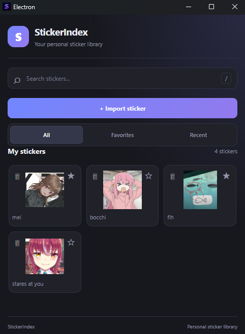
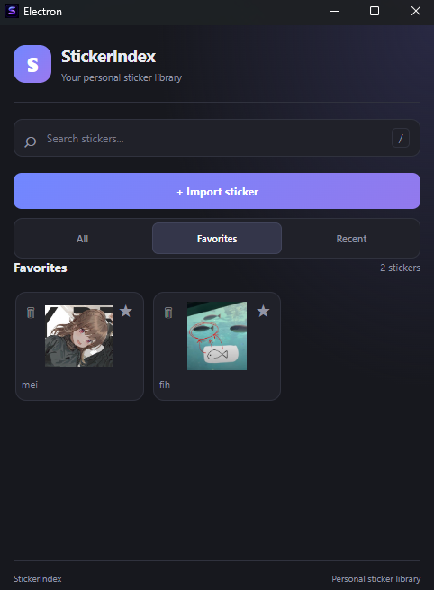
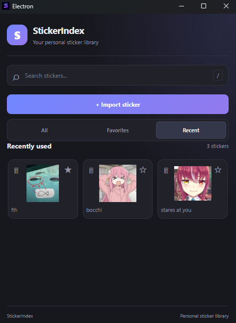

# StickerIndex

A lightweight Windows desktop application to organize, search, favorite, and copy your stickers with ease.

## Overview

StickerIndex is a desktop sticker manager designed to make organizing and using stickers simple and convenient.

Import your own images, organize your collection, mark your favorite stickers, and quickly copy them to your clipboard through a compact interface.

## Features

- **Sticker Import:** Import images directly from your computer.
- **Sticker Gallery:** Browse your entire sticker collection in one place.
- **Search:** Quickly find stickers by name.
- **Favorites:** Save your favorite stickers for easy access.
- **Recently Used:** Keep track of recently copied stickers.
- **Clipboard Integration:** Copy stickers directly to your clipboard.
- **Sticker Management:** Delete imported stickers you no longer need.
- **System Tray:** Keep StickerIndex running in the background.
- **Global Shortcut:** Open the application using `Ctrl + Shift + S`.
- **Local Storage:** Stickers, favorites, and recently used items are stored locally.

## Screenshots







## Supported Formats

- PNG
- JPG
- JPEG
- WEBP

## Installation

1. Visit the [Releases](https://github.com/FrightV/StickerIndex/releases) page.
2. Download the latest `StickerIndex-setup.exe` installer.
3. Run the installer.
4. Open StickerIndex and start importing your stickers.

## Usage

1. Open StickerIndex.
2. Click **Import sticker** to add images from your computer.
3. Browse your collection or use the search bar to find a specific sticker.
4. Click a sticker to copy it to your clipboard.
5. Use the favorites and recently used tabs to access stickers more easily.

### Keyboard Shortcut

Use the following global shortcut to open StickerIndex:

`Ctrl + Shift + S`

The application must be running in the background for the shortcut to work.

### System Tray

Clicking the window's close button hides StickerIndex in the system tray instead of closing the application.

You can reopen the application or quit it completely through the tray menu.

## Data Storage

StickerIndex stores imported stickers and preferences locally on your computer.

Favorites and recently used stickers are saved between sessions.

No account or online server is required.

## Technologies

- [Electron](https://www.electronjs.org/)
- [React](https://react.dev/)
- [TypeScript](https://www.typescriptlang.org/)
- [Vite](https://vite.dev/)
- [electron-builder](https://www.electron.build/)

## Development

### Requirements

- Node.js
- npm
- Git

### Getting Started

Clone the repository:

```bash
git clone https://github.com/FrightV/StickerIndex.git
```

Navigate to the project directory:

```bash
cd StickerIndex
```

Install dependencies:

```bash
npm install
```

Start the application in development mode:

```bash
npm run dev
```

### Build

Run type checking and compile the application:

```bash
npm run build
```

Generate the Windows installer:

```bash
npm run build:win
```

The generated installer will be available inside the `dist` directory.

## Author

Created by [FrightV](https://github.com/FrightV).

## License

This project is licensed under the [MIT License](LICENSE).
